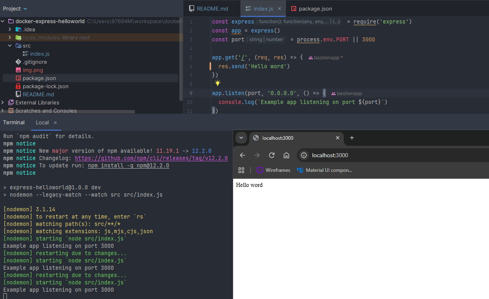
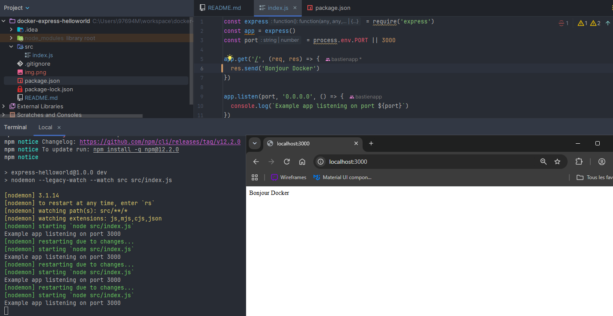

# Express Hello World

Small application for a Docker development environment exercise.

## Requirements

Use Node.js 24 and npm, locally or inside a container.

## Scripts

```sh
npm ci
npm start
```

For development, replace `npm start` with:

```sh
npm run dev
```

The server listens on `0.0.0.0:3000`.

Set `PORT` to change its internal port.


## Documentation Markdown
# Challenge Docker Express avec bind mount

## Questions initiales

### Qu'est-ce qu'un volume Docker ?

Un volume Docker est un espace de stockage persistant géré par Docker. Les données restent disponibles même après la suppression d'un conteneur.

### Qu'est-ce qu'un bind mount ?

Un bind mount permet de monter un dossier de la machine hôte dans un conteneur. Les modifications effectuées sur les fichiers sont immédiatement visibles dans le conteneur.

### Différence entre volume et bind mount

- Volume : géré par Docker, utilisé pour la persistance des données.
- Bind mount : lié à un dossier du système hôte, utilisé notamment en développement.

## Test de persistance

Création du volume :

docker volume create mon-volume

Création d'un conteneur utilisant ce volume :

docker run -d --name test1 -v mon-volume:/data alpine sleep 3600

Création d'un fichier :

docker exec test1 sh -c "echo Bonjour > /data/test.txt"

Suppression du conteneur :

docker rm -f test1

Création d'un nouveau conteneur utilisant le même volume :

docker run -d --name test2 -v mon-volume:/data alpine sleep 3600

Vérification :

docker exec test2 cat /data/test.txt

Résultat : Le fichier est toujours présent, la persistance est validée.

## Sources

- Documentation Docker Volumes : https://docs.docker.com/storage/volumes/
- Documentation Docker Bind Mounts : https://docs.docker.com/storage/bind-mounts/

## Commande Docker du challenge Express

docker run --rm -it -p 3000:3000 -v "${PWD}:/app" -w /app node:24 sh -c "npm ci && npm run dev"

## Explication
--rm : supprime le conteneur à l'arrêt.
-it : mode interactif.
-p 3000:3000 : expose le port 3000.
-v "${PWD}:/app" : bind mount du projet local.
-w /app : dossier de travail.
node:24 : image Node.js compatible avec le projet.
npm ci : installation des dépendances.
npm run dev : lancement de l'application avec nodemon.

## Adaptations du projet

Aucune adaptation nécessaire.
Le projet fournit déjà un script : "dev": "nodemon --legacy-watch --watch src src/index.js"
qui permet le rechargement automatique.

## Preuve du changement de texte
Avant
Application affichant "Hello World".

- captures/avant.png

Après
Application affichant "Bonjour vous !".

- captures/apres.png

Redémarrage automatique
Nodemon détecte la modification


